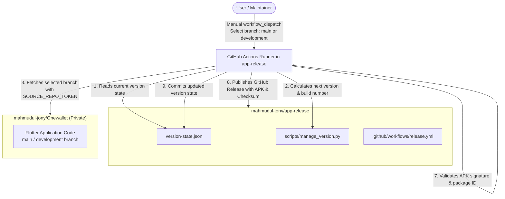
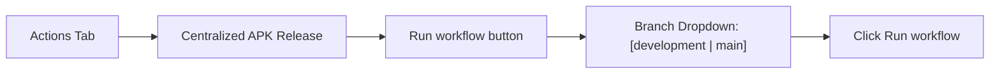

# Centralized Flutter APK Release System

A production-ready, centralized Android APK build and release management system hosted exclusively in [`app-release`](https://github.com/mahmudul-jony/app-release).

---

## 1. Project Purpose & Architecture

In traditional Flutter development workflows, each source repository often contains its own release pipelines, signing keys, and release tags. This scatters release automation, risks leaking signing credentials across repositories, and couples application source code with release mechanics.

The **Centralized Flutter APK Release System** solves this problem by decoupling application code from release infrastructure:

- **Source repositories** (e.g., [`mahmudul-jony/Onewallet`](https://github.com/mahmudul-jony/Onewallet)) contain **only** application code, flutter logic, and unit tests. They have **no** release workflows, no release credentials, and receive **no** automatic build commits.
- **The central release repository** (`mahmudul-jony/app-release`) owns the entire build, signing, version state tracking, and GitHub Release publication process.



---

## 2. Repository Responsibilities

| Responsibility | Source Repository (`Onewallet`) | Central Release Repository (`app-release`) |
|---|:---:|:---:|
| Application source code & UI | ✅ | ❌ |
| Unit tests & feature branches | ✅ | ❌ |
| Release workflows & pipelines | ❌ *(Forbidden)* | ✅ |
| Android release signing keystore & secrets | ❌ *(Forbidden)* | ✅ |
| Central version tracking & state file | ❌ | ✅ (`version-state.json`) |
| Version calculation & increment logic | ❌ | ✅ (`scripts/manage_version.py`) |
| GitHub Releases & downloadable APK assets | ❌ | ✅ |
| Auto-commit version bumps | ❌ *(Never committed)* | ✅ *(Committed to `app-release`)* |

---

## 3. Centralized Version Management

Version information is **strictly controlled** inside `app-release` and overrides any version defined in the source application's `pubspec.yaml`.

### Fresh Initial State
The system begins with an initial version state:
- **Version Name:** `1.0.0`
- **Build Number (`versionCode`):** `1`
- **Android Version Format:** `versionName+versionCode` (e.g. `1.0.0+1`)

### Branch Progression Rules

Android requires that `versionCode` (build number) **monotonically increase** for every APK produced. Reusing or decreasing a build number prevents installation over existing builds.

#### 1. Development Branch (`development`)
Triggering a release on `development`:
1. Increments the **patch portion** of the centrally stored version name by `1` (`X.Y.Z` $\rightarrow$ `X.Y.(Z+1)`).
2. Increments the **build number** by `1` (`B` $\rightarrow$ `B+1`).
3. Applies both values to the fetched project before building.

#### 2. Main Branch (`main`)
Triggering a release on `main`:
1. Keeps the **latest centrally stored version name unchanged** (`X.Y.Z` remains `X.Y.Z`).
2. Increments the **build number** by `1` (`B` $\rightarrow$ `B+1`).
3. Applies both values to the fetched project before building.

### Official Version Progression Lifecycle

| Build Step | Trigger Branch | Current Centrally Stored State | Applied Release Version (`versionName+versionCode`) | New State Saved in `app-release` |
|:---:|:---:|:---:|:---:|:---:|
| **Initial** | — | — | — | `1.0.0+1` |
| **Build 1** | `development` | `1.0.0+1` | `1.0.1+2` | `1.0.1+2` |
| **Build 2** | `development` | `1.0.1+2` | `1.0.2+3` | `1.0.2+3` |
| **Build 3** | `main` | `1.0.2+3` | `1.0.2+4` | `1.0.2+4` |
| **Build 4** | `main` | `1.0.2+4` | `1.0.2+5` | `1.0.2+5` |
| **Build 5** | `development` | `1.0.2+5` | `1.0.3+6` | `1.0.3+6` |

---

## 4. Central Version State File (`version-state.json`)

The state is stored in `version-state.json` at the repository root.

```json
{
  "$schema": "./schema/version-state.schema.json",
  "version": 1,
  "apps": {
    "onewallet": {
      "app_id": "onewallet",
      "app_name": "Onewallet",
      "repository": "mahmudul-jony/Onewallet",
      "package_name": "com.example.financeapp",
      "current_version_name": "1.0.0",
      "current_build_number": 1,
      "flutter_version": "3.41.9",
      "flutter_channel": "stable",
      "java_version": "17",
      "updated_at": "2026-11-15T00:00:00Z",
      "last_build": {
        "branch": null,
        "commit_sha": null,
        "version_name": "1.0.0",
        "build_number": 1,
        "release_tag": null,
        "built_at": null
      }
    }
  }
}
```

### Concurrency Protection & Safe State Updates
- **GitHub Actions Concurrency Lock:** The workflow enforces `concurrency: group: release-${{ inputs.app }}, cancel-in-progress: false`. Multiple triggers for the same app queue sequentially rather than executing in parallel.
- **Monotonic Guard:** The Python script [`manage_version.py`](file:///C:/Users/JONY/Desktop/app-release/scripts/manage_version.py) validates that `next_build_number > current_build_number`. Decreasing or reusing build numbers is rejected.
- **Atomic Rebase & Retry:** When writing back `version-state.json`, Git uses `git pull --rebase origin main` with automated retries to avoid race conditions.

---

## 5. Required GitHub Secrets & Access Configuration

Before running the workflow, configure the following secrets in the central repository:  
Navigate to: **Settings $\rightarrow$ Secrets and variables $\rightarrow$ Actions $\rightarrow$ New repository secret**.

| Secret Name | Required | Purpose | Example / Format |
|---|:---:|---|---|
| `SOURCE_REPO_TOKEN` | **Yes** | Personal Access Token (PAT) with read access to private source repo `mahmudul-jony/Onewallet`. | `github_pat_...` or classic PAT `ghp_...` |
| `ANDROID_KEYSTORE_BASE64` | **Yes** | Base64-encoded representation of the Android release keystore file (`.jks`). | Output of `base64 -w 0 upload-keystore.jks` |
| `ANDROID_KEYSTORE_PASSWORD` | **Yes** | Password of the Android keystore. | Keystore password string |
| `ANDROID_KEY_PASSWORD` | **Yes** | Password for the key entry inside the keystore. | Key password string |
| `ANDROID_KEY_ALIAS` | *Optional* | Key alias name inside the keystore. | Defaults to `upload` if omitted. |

> [!IMPORTANT]
> The built-in `GITHUB_TOKEN` is used for operations in `app-release` (creating releases, uploading APKs, and updating `version-state.json`). You do **not** need a separate token for `app-release`, provided workflow permissions are set to `Read and write permissions`.

### How to Configure `SOURCE_REPO_TOKEN`
1. Go to GitHub **Settings $\rightarrow$ Developer Settings $\rightarrow$ Personal Access Tokens $\rightarrow$ Fine-grained tokens** (or Tokens Classic).
2. Generate a token named `app-release-source-reader`:
   - Repository access: Select **Only select repositories** $\rightarrow$ `mahmudul-jony/Onewallet`.
   - Permissions: **Repository permissions $\rightarrow$ Contents $\rightarrow$ Read-only**.
3. Copy the token and add it as `SOURCE_REPO_TOKEN` in `mahmudul-jony/app-release`.

### How to Prepare `ANDROID_KEYSTORE_BASE64`
On your local terminal:
```bash
# Linux / macOS / Git Bash
base64 -w 0 upload-keystore.jks > keystore_base64.txt

# Windows PowerShell
[Convert]::ToBase64String([IO.File]::ReadAllBytes("upload-keystore.jks")) | Out-File -Encoding ascii keystore_base64.txt
```
Copy the contents of `keystore_base64.txt` and save it as the secret `ANDROID_KEYSTORE_BASE64`.

---

## 6. Android Signing & Build Configuration

The workflow dynamically restores the Android signing environment during build:

1. Creates `android/app` inside the runner's source checkout.
2. Decodes `ANDROID_KEYSTORE_BASE64` to `android/app/upload-keystore.jks` and `android/upload-keystore.jks`.
3. Creates `android/key.properties`:
   ```properties
   storePassword=<from ANDROID_KEYSTORE_PASSWORD>
   keyPassword=<from ANDROID_KEY_PASSWORD>
   keyAlias=<from ANDROID_KEY_ALIAS or upload>
   storeFile=upload-keystore.jks
   ```
4. Generates `android/local.properties` with the path to the Flutter SDK.
5. Invokes `flutter build apk --release --build-name=<VERSION_NAME> --build-number=<BUILD_NUMBER>`.

---

## 7. How to Manually Run the Workflow

Builds are triggered exclusively on-demand:

1. Navigate to [`mahmudul-jony/app-release`](https://github.com/mahmudul-jony/app-release).
2. Click the **Actions** tab.
3. In the left sidebar, click **Centralized APK Release**.
4. Click the **Run workflow** dropdown button on the right.
5. Select inputs:
   - **Source branch to build:** Choose either `development` or `main`.
   - **Application identifier:** Select `onewallet`.
6. Click **Run workflow**.



---

## 8. Release Assets & Publishing

Releases are published directly to **`mahmudul-jony/app-release`**. No releases are created in `Onewallet`.

### Release Tags & Titles
- **Tag Format:** `{app_id}-v{version_name}+{build_number}-{branch}`  
  *Example:* `onewallet-v1.0.1+2-development` or `onewallet-v1.0.2+4-main`
- **Release Title:** `{app_name} v{version_name}+{build_number} ({branch})`  
  *Example:* `Onewallet v1.0.1+2 (development)`

### Assets Attached to Each Release
1. **Signed Release APK:** `{app_id}-v{version_name}+{build_number}-{branch}.apk`  
   *Example:* `onewallet-v1.0.1+2-development.apk`
2. **SHA-256 Checksum:** `{app_id}-v{version_name}+{build_number}-{branch}.apk.sha256`

### Release Notes Included
Each release includes:
- Application name & Package identifier
- Version name & Build number (`versionCode`)
- Selected source branch
- Exact source commit SHA with link
- Build timestamp (UTC)

---

## 9. Verification & APK Validation Step

Before any release is published, the workflow performs strict automated validation on the generated APK:

1. **Existence Check:** Confirms the APK file was produced in `build/app/outputs/flutter-apk/app-release.apk`.
2. **Cryptographic Signature Verification:** Executes Android SDK `apksigner verify --verbose` to ensure the APK is validly signed with v1/v2/v3 signing schemes and not corrupted.
3. **Package Identifier Verification:** Executes `aapt dump badging` and confirms the package name matches the registered `package_name` (e.g. `com.example.financeapp`).
4. **Integrity Checksum:** Computes `sha256sum` and packages it with the release.

If any check fails, the workflow immediately terminates: **no release is published, and `version-state.json` is not updated**.

---

## 10. How to Add Another Application in the Future

The architecture is designed to support multiple Flutter apps from a single release hub:

1. **Register the app in `version-state.json`:**
   Add a new entry under `"apps"`:
   ```json
   "myotherapp": {
     "app_id": "myotherapp",
     "app_name": "My Other App",
     "repository": "mahmudul-jony/MyOtherApp",
     "package_name": "com.example.myotherapp",
     "current_version_name": "1.0.0",
     "current_build_number": 1,
     "flutter_version": "3.41.9",
     "flutter_channel": "stable",
     "java_version": "17",
     "updated_at": "2026-11-15T00:00:00Z",
     "last_build": null
   }
   ```
2. **Add the app identifier to `.github/workflows/release.yml` inputs:**
   ```yaml
   app:
     description: 'Application identifier'
     required: true
     default: 'onewallet'
     type: choice
     options:
       - onewallet
       - myotherapp
   ```
3. Ensure `SOURCE_REPO_TOKEN` has read access to the new repository (or provide an app-specific token).

---

## 11. Security Considerations & GitHub Permissions

1. **Workflow Permissions:**
   The workflow explicitly requests minimal permissions:
   ```yaml
   permissions:
     contents: write
   ```
   Under **Repository Settings $\rightarrow$ Actions $\rightarrow$ General $\rightarrow$ Workflow permissions**, verify that **Read and write permissions** is selected.

2. **Zero Source Pollution:**
   The workflow clones the source project with a read-only token and updates `pubspec.yaml` only inside the disposable GitHub Actions runner filesystem. It **never** runs `git push` against the source repository.

3. **Secret Hygiene:**
   - Keystores and passwords are never checked into Git.
   - Values are injected strictly via masked environment variables.
   - Logs do not print raw credentials or decoded keystores.

---

## 12. Troubleshooting Common Issues

### 1. `SOURCE_REPO_TOKEN` Authentication Failed
- **Symptom:** `fatal: Authentication failed for 'https://github.com/mahmudul-jony/Onewallet.git/'`.
- **Solution:** Verify `SOURCE_REPO_TOKEN` is added in `app-release` secrets and has `Contents: Read-only` access to `mahmudul-jony/Onewallet`.

### 2. Android Signing Secrets Missing
- **Symptom:** `The following required GitHub Secrets are missing in app-release repository: ANDROID_KEYSTORE_BASE64...`.
- **Solution:** Ensure all secrets listed in Section 5 are configured in `app-release` repository settings.

### 3. Keystore Decrypt / Password Failure
- **Symptom:** `Keystore was tampered with, or password was incorrect` during `flutter build apk`.
- **Solution:** Verify `ANDROID_KEYSTORE_PASSWORD` and `ANDROID_KEY_PASSWORD`. Check that `base64` encoding did not include extra newline characters or UTF-16 formatting.

### 4. Branch Not Found in Source Repository
- **Symptom:** `fatal: Remote branch development not found in upstream origin`.
- **Solution:** Ensure the branch (`development` or `main`) exists and has been pushed to `mahmudul-jony/Onewallet`.

### 5. Push to `version-state.json` Blocked by Branch Protection
- **Symptom:** `remote: error: GH006: Protected branch update failed for refs/heads/main`.
- **Solution:** In `app-release` branch protection settings for `main`, allow `github-actions[bot]` to bypass pull request requirements, or use a PAT with repository bypass permissions.

---

## 13. Current Limitations & Scope

- **In-App Update Checker:** The application currently contains no remote update API client. APK downloads and in-app update checks will be implemented in a subsequent phase.
- **Manual Trigger Only:** Builds do not trigger automatically on code push. Builds must be initiated manually via `workflow_dispatch`.
- **Target OS:** Builds produce signed Android APKs (`.apk`). Android App Bundles (`.aab`) or iOS builds can be added in future iterations using the same centralized version state.
