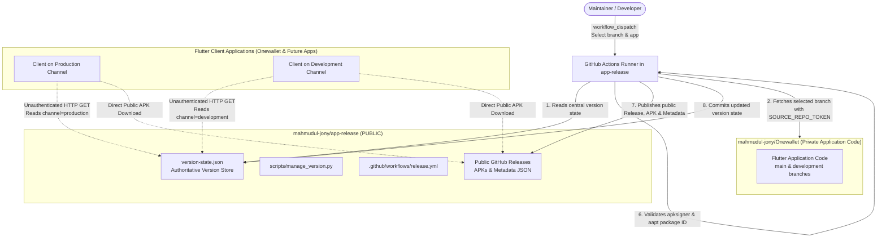

# Centralized Flutter APK Release System

A centralized, multi-application Android APK build, versioning, and release management hub hosted publicly in [`mahmudul-jony/app-release`](https://github.com/mahmudul-jony/app-release).

---

## 1. Project Purpose & Public Repository Architecture

The **Centralized Release System** decouples Flutter application source code from release pipelines, signing keys, and release artifacts:

- **Source Application Repositories** (such as [`mahmudul-jony/Onewallet`](https://github.com/mahmudul-jony/Onewallet)) contain **only** application code. They do not maintain release workflows, do not store signing credentials, and never receive automated version-bump commits.
- **The Central Release Repository** (`mahmudul-jony/app-release`) is a **PUBLIC** repository that manages all version state, executes the signed build pipeline on GitHub Actions runners, publishes public GitHub Releases, and serves as the public download hub.



### Public Access Guarantee
- The release repository is **public**.
- All GitHub Releases, APK binaries, checksums, and metadata files can be downloaded **without authentication** by any HTTP client or browser.
- **Never embed GitHub Personal Access Tokens or API keys inside the Flutter application**. The public endpoints require zero credentials.

---

## 2. Multi-Application Support & Discovered Configuration

The system is architected from day one to support multiple independent applications without risk of collisions or ambiguity.

### Initial Application: Onewallet
- **Application Identifier (`app_id`):** `onewallet` (stable identifier used in tags, assets, and APIs)
- **Application Name:** `Onewallet`
- **Source Repository:** `mahmudul-jony/Onewallet`
- **Application / Package ID:** `com.example.financeapp`  
  *(Discovered directly from `android/app/build.gradle.kts`: `namespace = "com.example.financeapp"` and `applicationId = "com.example.financeapp"`)*
- **Build Toolchain:** Flutter `3.41.9` (stable channel), Java `17` (temurin), Gradle `8.14`

---

## 3. Release Channels: Production (`main`) vs Development (`development`)

The release system enforces strict separation between release channels:

| Source Branch | Release Channel | GitHub Release Type | Release Tag Pattern | Pre-release Flag | Intended Audience |
|:---:|:---:|:---:|:---:|:---:|:---:|
| `main` | **Production** | Official Release | `{app}-v{ver}+{build}-production` | `prerelease: false` | End users / Production |
| `development` | **Development** | Pre-Release | `{app}-v{ver}+{build}-development` | `prerelease: true` | Testers / Internal QA |

### Channel Rules
1. **No Confusion:** Production releases (`-production`) and development releases (`-development`) have distinct tags, titles, asset filenames, and metadata records.
2. **Channel Flagging:** In GitHub Releases, development builds are flagged with `--prerelease`. Production builds are flagged as full releases.
3. **Never Intermingled:** A client application requesting production updates will never be offered a development build, and vice-versa.

---

## 4. Centralized Version Management

Version information is stored and incremented exclusively inside `app-release`. The source application repository's `pubspec.yaml` is **not** authoritative and is never modified on GitHub.

### Fresh Version State
Version tracking starts completely fresh:
- **Initial Version Name:** `1.0.0`
- **Initial Build Number (`versionCode`):** `1`
- **Android Version Format:** `versionName+versionCode` (e.g. `1.0.0+1`)

### Progression Rules

#### Development Branch (`development` $\rightarrow$ `development` channel)
1. Automatically increases the **patch portion** of the centrally stored version name by `1` (`X.Y.Z` $\rightarrow$ `X.Y.(Z+1)`).
2. Increases the centrally stored **build number** by `1` (`B` $\rightarrow$ `B+1`).
3. Applies both values to the runner's workspace before building.

#### Main Branch (`main` $\rightarrow$ `production` channel)
1. Keeps the **latest centrally stored version name unchanged** (`X.Y.Z` remains `X.Y.Z`).
2. Increases the centrally stored **build number** by `1` (`B` $\rightarrow$ `B+1`).
3. Applies both values to the runner's workspace before building.

> [!IMPORTANT]
> **Monotonic `versionCode` Requirement:** Android strictly forbids installing an APK with a `versionCode` equal to or lower than an existing installation. Therefore, the build number **must strictly increase for every build**, regardless of whether the build is for `development` or `main`. Build numbers are never reused or decreased.

### Official Version Progression Lifecycle

| Build Step | Source Branch | Target Channel | Current Central State | Applied Build Version | New Central State | Tag Published | Prerelease |
|:---:|:---:|:---:|:---:|:---:|:---:|:---:|:---:|
| **Initial** | — | — | — | — | `1.0.0+1` | — | — |
| **Build 1** | `development` | `development` | `1.0.0+1` | `1.0.1+2` | `1.0.1+2` | `onewallet-v1.0.1+2-development` | `true` |
| **Build 2** | `development` | `development` | `1.0.1+2` | `1.0.2+3` | `1.0.2+3` | `onewallet-v1.0.2+3-development` | `true` |
| **Build 3** | `main` | `production` | `1.0.2+3` | `1.0.2+4` | `1.0.2+4` | `onewallet-v1.0.2+4-production` | `false` |
| **Build 4** | `main` | `production` | `1.0.2+4` | `1.0.2+5` | `1.0.2+5` | `onewallet-v1.0.2+5-production` | `false` |
| **Build 5** | `development` | `development` | `1.0.2+5` | `1.0.3+6` | `1.0.3+6` | `onewallet-v1.0.3+6-development` | `true` |

---

## 5. Central Version State File (`version-state.json`)

Located at the repository root, [`version-state.json`](file:///C:/Users/JONY/Desktop/app-release/version-state.json) maintains the central record for each application and channel:

```json
{
  "$schema": "./schema/version-state.schema.json",
  "version": 1,
  "apps": {
    "onewallet": {
      "app_id": "onewallet",
      "app_name": "Onewallet",
      "repository": "mahmudul-jony/Onewallet",
      "package_name": "com.example.financeapp",
      "current_version_name": "1.0.0",
      "current_build_number": 1,
      "flutter_version": "3.41.9",
      "flutter_channel": "stable",
      "java_version": "17",
      "updated_at": "2026-11-15T00:00:00Z",
      "channels": {
        "production": {
          "channel": "production",
          "version_name": "1.0.0",
          "build_number": 1,
          "release_tag": null,
          "apk_asset_name": null,
          "apk_download_url": null,
          "sha256_download_url": null,
          "commit_sha": null,
          "published_at": null
        },
        "development": {
          "channel": "development",
          "version_name": "1.0.0",
          "build_number": 1,
          "release_tag": null,
          "apk_asset_name": null,
          "apk_download_url": null,
          "sha256_download_url": null,
          "commit_sha": null,
          "published_at": null
        }
      },
      "last_build": {
        "channel": null,
        "branch": null,
        "commit_sha": null,
        "version_name": "1.0.0",
        "build_number": 1,
        "release_tag": null,
        "built_at": null
      }
    }
  }
}
```

### Concurrency Protection & Safe State Updates
- **GitHub Actions Concurrency Queue:** The workflow specifies `concurrency: group: release-${{ inputs.app }}, cancel-in-progress: false`. Multiple triggers for the same app queue sequentially.
- **Strict Monotonicity:** [`scripts/manage_version.py`](file:///C:/Users/JONY/Desktop/app-release/scripts/manage_version.py) rejects any update where `new_build_number <= current_build_number`.
- **Atomic Git Rebase:** Changes to `version-state.json` are committed and pushed using `git pull --rebase origin main` with a 3-attempt retry loop.

---

## 6. Required GitHub Secrets & Setup

Configure the following secrets in the central repository:  
Navigate to **Settings $\rightarrow$ Secrets and variables $\rightarrow$ Actions $\rightarrow$ New repository secret**.

| Secret Name | Required | Purpose |
|---|:---:|---|
| `SOURCE_REPO_TOKEN` | **Yes** | Personal Access Token (classic or fine-grained) with **Contents: Read-only** permission to private repo `mahmudul-jony/Onewallet`. |
| `ANDROID_KEYSTORE_BASE64` | **Yes** | Base64-encoded string of the Android `.jks` release keystore. |
| `ANDROID_KEYSTORE_PASSWORD` | **Yes** | Keystore store password. |
| `ANDROID_KEY_PASSWORD` | **Yes** | Key password for key entry. |
| `ANDROID_KEY_ALIAS` | *Optional* | Key alias (defaults to `upload` if omitted). |

### Generating the Base64 Keystore String
- **Windows PowerShell:**
  ```powershell
  [Convert]::ToBase64String([IO.File]::ReadAllBytes("upload-keystore.jks")) | Set-Clipboard
  ```
- **macOS / Linux:**
  ```bash
  base64 -w 0 upload-keystore.jks
  ```

---

## 7. How to Manually Trigger a Release Build

1. Go to [`mahmudul-jony/app-release`](https://github.com/mahmudul-jony/app-release).
2. Click the **Actions** tab.
3. Select **Centralized APK Release** from the left sidebar.
4. Click **Run workflow** on the right side:
   - **Source branch to build:** Select `development` or `main`.
   - **Application identifier:** Select `onewallet`.
5. Click the green **Run workflow** button.

---

## 8. Release Assets & Publishing Structure

Releases are published directly to **`mahmudul-jony/app-release`**.

### Release Tag & Title Conventions
- **Production Release:**
  - Tag: `onewallet-v1.0.2+4-production`
  - Title: `Onewallet v1.0.2+4 (Production)`
- **Development Release:**
  - Tag: `onewallet-v1.0.1+2-development`
  - Title: `Onewallet v1.0.1+2 (Development)`

### Assets Attached to Each Release
Every release includes three publicly accessible assets:
1. **Signed APK:** `{app_id}-v{version}+{build}-{channel}.apk`  
   *(e.g., `onewallet-v1.0.1+2-development.apk`)*
2. **SHA-256 Checksum:** `{app_id}-v{version}+{build}-{channel}.apk.sha256`
3. **Machine-Readable Metadata:** `{app_id}-v{version}+{build}-{channel}-metadata.json`

---

## 9. Public Release Metadata & Future API Integration Strategy

> [!WARNING]
> **Why `/releases/latest` must NOT be used:**  
> GitHub's `/repos/{owner}/{repo}/releases/latest` endpoint returns only the single latest release published in the entire repository across all apps and channels. If App B publishes an update or a development build is published, `/releases/latest` points to that release, breaking update lookups for production or other apps.

To provide predictable, reliable, and unauthenticated update lookups for future client applications, two standard strategies are supported:

### Strategy A: Direct Raw State Lookup (Recommended for In-App Update Checkers)

Client applications can fetch the central state directly via raw CDN:

```http
GET https://raw.githubusercontent.com/mahmudul-jony/app-release/main/version-state.json
```

- **Authentication:** None required.
- **Rate Limits:** Extremely high (served through GitHub's Fastly CDN edge).
- **Client Discovery Logic:**
  1. The client knows its own `app_id` (e.g. `onewallet`) and channel (e.g. `production` or `development`).
  2. Parses `data["apps"][app_id]["channels"][channel]`.
  3. Checks if `remote_build_number > local_build_number`.
  4. If an update is available, downloads the APK directly from `apk_download_url` and verifies integrity with `sha256_download_url`.

### Strategy B: Public GitHub Releases REST API

Client applications can query GitHub's public releases endpoint without an API token:

```http
GET https://api.github.com/repos/mahmudul-jony/app-release/releases
```

- **Authentication:** None required for public repositories.
- **Client Filtering Logic:**
  1. Filter releases where `tag_name.startsWith("${app_id}-")`.
  2. For `production`: filter where `tag_name.endsWith("-production")` and `prerelease == false`.
  3. For `development`: filter where `tag_name.endsWith("-development")` and `prerelease == true`.
  4. The first matching release in the array is the newest release for that channel.
  5. Read the `.apk` asset's `browser_download_url`.

### Machine-Readable Metadata Asset Format (`metadata.json`)

Each release includes an attached JSON file formatted as follows:

```json
{
  "schema_version": 1,
  "app_id": "onewallet",
  "app_name": "Onewallet",
  "package_name": "com.example.financeapp",
  "version_name": "1.0.1",
  "build_number": 2,
  "version_full": "1.0.1+2",
  "channel": "development",
  "is_prerelease": true,
  "source_branch": "development",
  "source_commit_sha": "0905b78f7e09d739db0f2a0f8bd24a9551756316",
  "release_tag": "onewallet-v1.0.1+2-development",
  "release_title": "Onewallet v1.0.1+2 (Development)",
  "published_at": "2026-11-15T02:30:00Z",
  "apk": {
    "asset_name": "onewallet-v1.0.1+2-development.apk",
    "download_url": "https://github.com/mahmudul-jony/app-release/releases/download/onewallet-v1.0.1+2-development/onewallet-v1.0.1+2-development.apk",
    "sha256": "4b9a38f...e3b0c",
    "sha256_download_url": "https://github.com/mahmudul-jony/app-release/releases/download/onewallet-v1.0.1+2-development/onewallet-v1.0.1+2-development.apk.sha256",
    "size_bytes": 18432100
  }
}
```

---

## 10. How to Add Another Application in the Future

1. **Register the app in [`version-state.json`](file:///C:/Users/JONY/Desktop/app-release/version-state.json):**
   ```json
   "myotherapp": {
     "app_id": "myotherapp",
     "app_name": "My Other App",
     "repository": "mahmudul-jony/MyOtherApp",
     "package_name": "com.example.myotherapp",
     "current_version_name": "1.0.0",
     "current_build_number": 1,
     "flutter_version": "3.41.9",
     "flutter_channel": "stable",
     "java_version": "17",
     "updated_at": "2026-11-15T00:00:00Z",
     "channels": {
       "production": { "channel": "production", "version_name": "1.0.0", "build_number": 1, ... },
       "development": { "channel": "development", "version_name": "1.0.0", "build_number": 1, ... }
     },
     "last_build": null
   }
   ```
2. **Add the identifier to `.github/workflows/release.yml` inputs:**
   ```yaml
   app:
     description: 'Application identifier'
     required: true
     default: 'onewallet'
     type: choice
     options:
       - onewallet
       - myotherapp
   ```
3. Grant `SOURCE_REPO_TOKEN` read access to the new application's repository.

---

## 11. Troubleshooting Common Issues

1. **Authentication Error on Source Checkout:**
   - Verify `SOURCE_REPO_TOKEN` is configured in `app-release` secrets and has `Contents: Read-only` access to `mahmudul-jony/Onewallet`.
2. **Package Identifier Mismatch:**
   - The validation step checks `aapt dump badging` against `package_name` in `version-state.json`. For Onewallet, this must match `com.example.financeapp`.
3. **Android Keystore Decryption Failure:**
   - Ensure `ANDROID_KEYSTORE_BASE64` contains raw base64 without whitespace or UTF-16 BOM prefixes. Verify `ANDROID_KEYSTORE_PASSWORD` and `ANDROID_KEY_PASSWORD`.
4. **Push Conflict on `version-state.json`:**
   - Handled automatically by the workflow's 3-attempt `git pull --rebase origin main` retry loop.

---

## 12. Current Scope Restrictions

As specified, the following features are reserved for future phases:
- Flutter in-app update checker logic and background update timers.
- APK download manager and Android package installer MethodChannels inside Onewallet.
- Automatic builds triggered on code push.
- Workflows or pipeline configurations inside the Onewallet repository.
